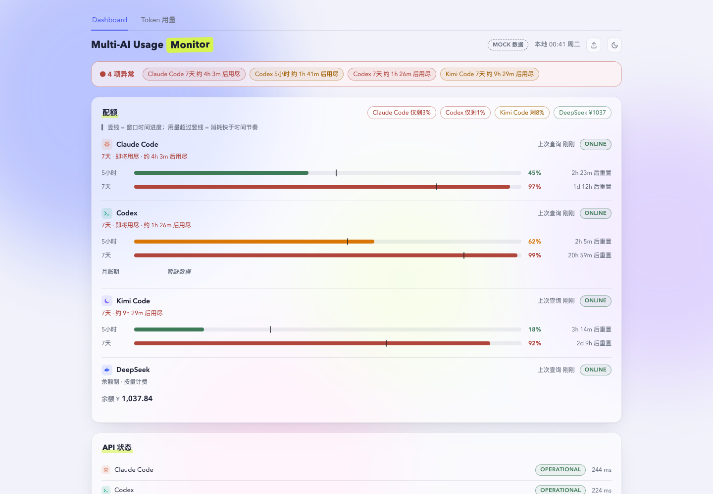
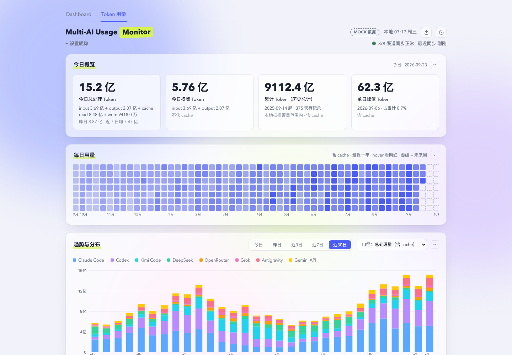
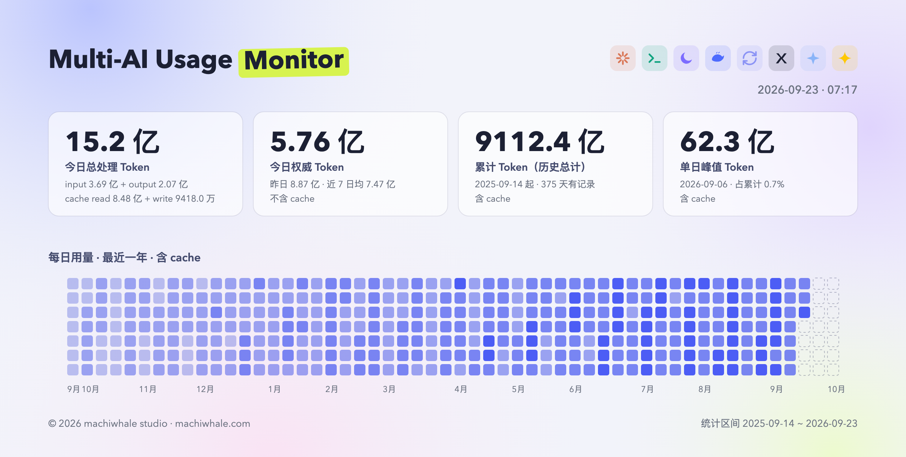

# api-usage-board — AI API 用量监控 Dashboard

**v2.3** · 深/浅双主题监控台，一屏看完 **10 个 AI 编程工具/API 渠道**的配额、token 用量和费用：
Claude Code / Codex / Kimi Code / DeepSeek / OpenRouter / Grok Build / Grok Bot / Cursor / Antigravity / Gemini API。

纯前端 vanilla HTML/CSS/JS（ES modules），无构建步骤、无外部依赖、无 CDN；本地 server
只用 Node 内置模块，零 npm 依赖。数据全部读取你本机已有的 CLI 凭证/日志，**不上传任何数据**。

> 产品原型借鉴自公众号「杂谈by立行」文章
> [《人生的塞尔达时期：日均40亿Token的那一周》](https://mp.weixin.qq.com/s/9IQzxijlbDdLiAiS8np5aQ)，
> 供开发学习和自用。




**一键分享卡**：



## 快速开始

**1. 前置条件**：Node ≥18。

**2. 克隆并启动**：

```bash
git clone https://github.com/isalicema/api-usage-board.git
cd api-usage-board
./serve.command
```

浏览器打开 `http://127.0.0.1:8177`。

**3. 看懂第一屏**：**你电脑上装了哪个 AI 工具，对应渠道就自动亮起**——这些工具登录后都会
在本地留一份凭证文件，这个 dashboard 只是读它们，不需要你额外配置。没装的渠道显示灰色
「未配置」/「未运行」，不影响其他渠道，**不需要凑齐 10 个才能用**。

**4.（可选）配置 OpenRouter**：唯一一个需要手动配置的渠道（不是本地 CLI 工具）。
Dashboard 页面 OpenRouter 卡片未配置时会显示「未配置 key → 如何获取 key」，点一下就有
分步说明。不用的话直接忽略。

**5.（可选）设置订阅套餐**：切到「Token 用量」tab 底部「费用预估与套餐回报」面板，
每个渠道套餐旁边是下拉选择框，选完立刻生效，**不需要手改配置文件**。

## 常驻运行（可选）

不想每次都手动开终端，可以用 macOS 快捷指令 App 做一个开机自启/桌面一键启动：

新建快捷指令 →「运行 Shell 脚本」操作，内容：

```bash
nohup "/path/to/api-usage-board/serve.command" >/dev/null 2>&1 &
```

必须 `nohup ... &` 后台化：快捷指令会等脚本退出才算完成，`serve.command` 里的 server 是
常驻前台进程，不后台化的话快捷指令会一直转圈、且脚本被回收时 server 也会被带走。
（可选）把该快捷指令加到登录项，实现开机自启。

服务已经在跑的时候重复运行没关系，`serve.command` 会先探测 8177 端口，占用了就只打开
浏览器页面，不会重复起一个 server。

**服务日志**：`serve.command` 会把服务输出同时写进 `~/Library/Logs/api-usage-board/server.log`（超过 2MB 启动时轮转成 `server.log.1`），所以即使用上面的快捷指令后台启动，也能查到运行时的提示和错误：

```bash
tail -f ~/Library/Logs/api-usage-board/server.log
```

**快捷指令偶发没唤起页面时**：上面命令把输出丢进了 `/dev/null`，脚本没跑起来和跑了但报错看起来一模一样。想留下排查线索，可以把命令末尾改成追加到一个启动日志：

```bash
nohup "/path/to/api-usage-board/serve.command" >> ~/Library/Logs/api-usage-board/launch.log 2>&1 &
```

之后再遇到没唤起：`launch.log` 没有新内容，说明快捷指令没执行到脚本；有内容，就是脚本跑了，看里面的报错。（服务运行时的输出仍在 `server.log`。）

## 功能一览

- **Dashboard**：每渠道配额进度条 + 用尽预警横幅（按消耗速度外推还有多久用尽）+ 状态徽标
  （ONLINE / STALE / OFFLINE / NO KEY / 未运行）
- **Token 用量**：今日概览、一年视图热力图、趋势堆叠图、Coding Agent / 模型 / 项目三个
  分布面板、费用预估与订阅 ROI
- 深/浅主题切换、server 没起时自动回退示意数据（不会白屏）

## 配置文件

| 文件 | 内容 | 说明 |
|---|---|---|
| `server/.env` | `OPENROUTER_MANAGEMENT_KEY=sk-or-...` | `cp server/.env.example server/.env` 后填真实 key，建议 `chmod 600 server/.env` |
| `server/config.json` | `projectAliases` / `modelPrices` / `subscriptions` / `cnyUsdRate` | mtime 热加载，改完不用重启。`subscriptions` 可以在页面上选，不用手改文件；`projectAliases`/`modelPrices` 仍需手改，`modelPrices` 是占位刊例价，请按官方价格页核实 |

## 历史数据保留

各渠道只在最近 95～110 天的窗口里**扫描**日志，但累计用量不会随窗口滚动缩水：`server/history-archive.mjs` 会把每个渠道的每日用量永久归档到 `server/data/history-archive.json`（不进 git），之后展示的是「归档与当前扫描逐字段取较大值」——扫描窗口滚过去、日志被工具压缩/清理、扫描缓存被重置，已经归档的历史都还在。只增不减，且重复合并不会重复计数；只归档已稳定的日期（早于今天 2 天），近几天以当前扫描为准。

- 升级前已经滚出窗口的历史，如果原始日志还在磁盘上（例如 Codex 的会话文件），先停掉看板服务，再用 `AUB_SCAN_DAYS=400 ./serve.command` 启动一次补回，之后归档会记住，不用一直开着。Claude Code 自己会清理 30 天前的本地日志，滚出去的部分无法补回，归档从升级那天起开始保护。
- 想修正某天的归档（往下改，比如发现某天被重复计数）：先停服务，再 `node server/tools/archive.mjs drop <渠道> <YYYY-MM-DD>`，重启后该渠道重新扫出正确值。`node server/tools/archive.mjs stats` 查看各渠道归档范围。
- 扫描缓存（`server/.cache/*.json`）也有保护：写入前每天留一份备份（`*.bak-YYYYMMDD`，保留 7 份），读失败不会被当成空缓存覆盖，内容突然缩水一半以上会先另存。
- Codex 新版会把老会话压成 `.jsonl.zst`，现在可以直接读（按会话去重，压缩前后不会重复计数）。

## 已知限制

- Claude/Codex 的配额直连走的是未公开接口（跟随官方客户端行为），可能随时漂移；都有降级链（直连失败→旧方案→offline），不会直接报错
- Antigravity **配额**仍靠机会主义采集，凭证位置未定位，只有 agy 运行时才能查到，不跑则显示"未运行"；**Token 用量**从 CLI（`~/.gemini/antigravity-cli`）和桌面客户端（`~/.gemini/antigravity`）两处本地会话库解析，跟 agy 是否运行无关（社区 PR #1 贡献）；旧格式 `.pb` 会话读不了
- 从旧版升级：旧版漏算桌面客户端用量，跨天的 CLI 会话也可能记错日期。升级后首次扫描会自动补算，并把历史归档里记错日期的部分挪到正确日期（不重复计数），所以一些历史日期的数字会变；迁移前的归档另存为 `server/data/history-archive.json.pre-rekey`。自动迁移依赖旧版的扫描缓存：升级前如果删掉过 `server/.cache/` 里的 Antigravity 缓存和备份，迁移不会发生，部分日期可能重复计数，需要停掉服务后用 `archive.mjs drop` 清掉受影响的日期再重扫（现有会话文件复现不出的旧数据会一起清掉）
- Grok Build（Grok CLI / SuperGrok）的 token 序列是上下文快照近似值，不是精确计量
- Cursor 没有本地干净日志：在 Token 用量 tab 的 Coding Agent 面板里占位（标「仅配额 · 见 Dashboard」），不进趋势/费用
- Grok Bot（Sand 架构）：**配额**优先通过 Cursor 凭证接口请求，网络异常或凭证过期时自动回退读取桌面客户端本地切片（`weekly-usage.cache`，过期标记 stale 并提示离线）；**Token 用量**支持通过本地会话切片（`transcript.replicas`）进行会话文本估算（去重累加，仅本地可见部分，暂不进费用估值与订阅回报）
- Gemini API 没有官方用量查询接口，只能读客户端留在本地的会话记录：目前支持 **Gemini CLI**（API key 模式）和 **OpenCode**（Google provider）。自己写脚本直接调 API 的用量采集不到；费用按官方刊例价估算。两个数据源的格式依据官方源码实现，尚未经真实用户数据验证，欢迎反馈

## 安全

- key/token 只进 server 进程内存，绝不出现在 API 响应、日志、前端里
- server 只绑 `127.0.0.1`；静态服务拒绝一切 dotfile 路径（`server/.env` 经 HTTP 不可读）
- `/api/*` 出错不透出内部细节

更详细的技术实现（各渠道具体接口/凭证路径、缓存策略、验证脚本）见 [`docs/ARCHITECTURE.md`](docs/ARCHITECTURE.md)。

## License

MIT

---

Made with Kimi K3 by Machiwhale Studio
